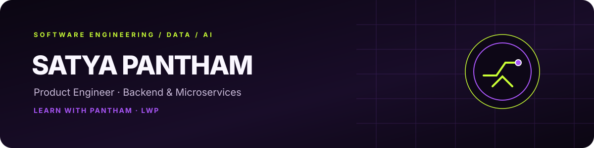

### Backend Engineering · Data Engineering · AI

Building reliable software, exploring data systems, and learning in public.

---

## `whoami` — About me

I'm a **Product Engineer at Tata Consultancy Services (TCS)** working on backend engineering for enterprise banking software. My work includes developing and maintaining APIs and services, implementing business logic, testing, debugging, and supporting reliable software delivery.

My professional foundation is in **Java, Spring Boot, REST APIs, microservices, and event-driven systems**. I'm expanding my hands-on work in **Data Engineering and AI**, and sharing that learning journey through ****Learn with Pantham · LWP****.

- 🏢 **Current role:** Product Engineer — TCS
- 🧩 **Domain:** Core Banking, Trade Finance, SWIFT messaging
- ⚙️ **Interests:** Backend systems, distributed architecture, data pipelines, AI
- 🎓 **Education:** B.Tech, Computer Science & Engineering — CGPA 8.72/10
- 🌱 **Currently exploring:** Data Engineering, PySpark, LLM fundamentals, practical AI projects

## `toolbox` — Technology stack

**Backend & Languages**

| Area | Tools and concepts |
|---|---|
| **Backend** | Java, Spring Boot, Spring MVC, Spring Data JPA, Hibernate |
| **APIs & architecture** | REST APIs, Microservices, Apache Kafka, Event-driven architecture |
| **Databases** | SQL, Oracle, PostgreSQL |
| **Testing & delivery** | JUnit, integration testing, Swagger / OpenAPI, Maven, Jenkins, CI/CD |
| **Core engineering** | OOP, SOLID, design patterns, multithreading, collections, exception handling |
| **Banking domain** | TCS BaNCS, Core Banking, Trade Finance, SWIFT messaging |
| **Growing focus** | Python, Data Engineering, PySpark, AI / LLM engineering |

“Growing focus” represents current learning and project direction, not a claim of production-level experience with every tool.

## `selected_work` — Projects

### 🧠 LWP SQL-GPT 1.0
An educational project exploring how a GPT-style language model works: tokenization, a decoder-only Transformer, training, and evaluation, using SQL generation as a demonstration task.

**Focus:** Python · Transformers · Tokenization · Model training · Evaluation

> Add the public repository link here once the project URL is confirmed.

### 🩻 Knee Osteoarthritis Detection using Deep Learning
Built an image-classification pipeline using TensorFlow and ResNet50 transfer learning to classify knee osteoarthritis severity from X-ray images, achieving **81.2% classification accuracy** on the evaluated dataset.

**Focus:** TensorFlow · ResNet50 · Transfer Learning · Image Classification

### 🔤 Handwritten Telugu Character Recognition
Developed a CNN-based OCR model using TensorFlow and Keras to recognise handwritten Telugu characters, achieving **85.7% accuracy** on the evaluated dataset.

**Focus:** TensorFlow · Keras · CNN · OCR

### 🚧 Data Engineering Pipeline — In progress
Building practical experience with data ingestion, transformation, validation, and analytics-ready outputs. Project details will be added as implementations become available.

## `learn_in_public` — Learn with Pantham

**Learn with Pantham · LWP**

**Learn with Pantham (LWP)** is my educational channel focused on AI, Data Engineering, software, and technology shaping our future. The goal: understand concepts deeply, build practical projects, and share useful explanations.

**A Will to Know. A Pantham to Grow.**

## `connect()` — Let's connect

I'm interested in backend engineering, distributed systems, Data Engineering, and practical AI. If you're building in these areas, feel free to connect.

- 💼 [LinkedIn](https://www.linkedin.com/in/satya-pantham-767435208/)
- 🎥 [YouTube — Learn with Pantham](https://www.youtube.com/channel/UChrvMmag1aRLoKz9QAOTYcQ)
- 📸 [Instagram — @learn_with_pantham](https://www.instagram.com/learn_with_pantham/)
- 🧑‍💻 [GitHub repositories](https://github.com/SatyaPantham-commit?tab=repositories)

---

Built with curiosity, consistency, and a Pantham to grow. 💜💚

