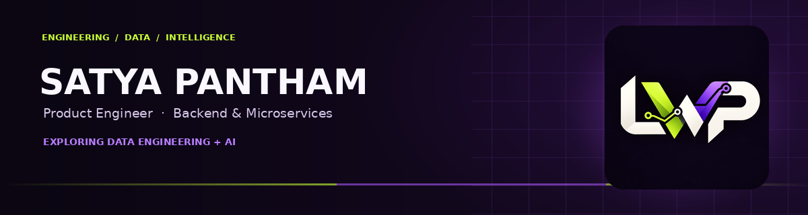

 

  

---

## 👋 Hi, I'm Satya.

I'm a **Product Engineer at Tata Consultancy Services (TCS)**, working on backend engineering for enterprise banking software. I enjoy building reliable services, understanding how systems work, and turning requirements into maintainable software.

My core experience is in **Java, Spring Boot, REST APIs, microservices, and event-driven architecture**. I'm now growing deeper into **Data Engineering and AI engineering**—building projects, strengthening fundamentals, and sharing what I learn through my educational channel, **Learn with Pantham (LWP)**.

- 🔭 **Currently building:** Practical projects in Data Engineering and AI
- 💼 **Professional focus:** Backend development, APIs, microservices, testing and delivery
- 🏦 **Domain experience:** Core Banking, Trade Finance, SWIFT messaging
- 🌱 **Learning next:** Python-based data pipelines, PySpark, LLM internals and evaluation
- 🎓 **Education:** B.Tech in Computer Science & Engineering · CGPA 8.72/10
- 💡 **Principle:** Understand the fundamentals. Build something real. Share the learning.

## 🧰 Tech I work with

| Category | Skills |
|---|---|
| **Languages & data** | Java, SQL, Oracle, PostgreSQL |
| **Backend** | Spring Boot, Spring MVC, Spring Data JPA, Hibernate, REST APIs |
| **Architecture & messaging** | Microservices, Apache Kafka, event-driven architecture |
| **Testing & delivery** | JUnit, integration testing, Swagger / OpenAPI, Maven, Jenkins, CI/CD |
| **Core engineering** | OOP, SOLID, design patterns, multithreading, collections, exception handling |
| **Domain knowledge** | TCS BaNCS, Core Banking, Trade Finance, SWIFT messaging |
| **Expanding into** | Python, Data Engineering, PySpark, AI / LLM engineering |

The “Expanding into” line reflects my current learning direction, not a claim of production experience with every tool.

## 🚀 Projects

### 🧠 LWP SQL-GPT 1.0
An independent educational project to understand how a GPT-style language model is built—from tokenization and a decoder-only Transformer to training and evaluation. The goal is learning model internals from randomly initialized weights, not competing with commercial LLMs.

**Exploring:** Python · Tokenization · Transformers · Training loops · Evaluation

> Add the repository link here when the project is public and the final URL is confirmed.

### 🩻 Knee Osteoarthritis Detection using Deep Learning
Built a TensorFlow image-classification pipeline using ResNet50 transfer learning to classify knee osteoarthritis severity from X-ray images, achieving **81.2% accuracy** on the evaluated dataset.

**Stack:** TensorFlow · ResNet50 · Transfer Learning · Image Classification

### 🔤 Handwritten Telugu Character Recognition
Developed a CNN-based handwritten Telugu character recognition model using TensorFlow and Keras, achieving **85.7% accuracy** on the evaluated dataset.

**Stack:** TensorFlow · Keras · CNN · OCR

### ⚙️ Data Engineering portfolio
I'm developing end-to-end projects that demonstrate data ingestion, transformation, data-quality checks, and analytics-ready outputs. I'll add implementation details and results as each project becomes ready to share.

## 🎥 Learn with Pantham

**Learn with Pantham (LWP)** is my educational channel about **AI, Data Engineering, software, and future technology**. I want to make complex topics easier to understand through practical explanations, experiments, and project walkthroughs.

### *A Will to Know. A Pantham to Grow.*

## 🤝 Connect with me

I'm always interested in conversations about backend engineering, distributed systems, data platforms, and practical AI.

- 💼 [LinkedIn](https://www.linkedin.com/in/satya-pantham-767435208/)
- 🎬 [YouTube — Learn with Pantham](https://www.youtube.com/channel/UChrvMmag1aRLoKz9QAOTYcQ)
- 📸 [Instagram — @learn_with_pantham](https://www.instagram.com/learn_with_pantham/)
- 💻 [Explore my GitHub repositories](https://github.com/SatyaPantham-commit?tab=repositories)

---

Build with purpose. Learn with curiosity. Grow with determination. 💜💚

